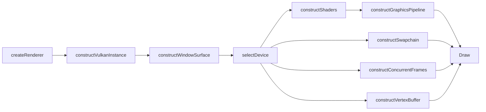

# PyraVK


**[PyraVK]("https://github.com/poBogan/PyraVK")** is a lightweight C++20 rendering library built on top of **Vulkan 1.3**. It wraps the boilerplate-heavy parts of Vulkan (instance, surface, device selection, swapchain, frames in flight, shaders, pipelines, and GPU buffers) behind a single, step-by-step `Renderer` interface, so you can go from an empty window to a triangle on screen in a few dozen lines.

It is built with modern Vulkan practices in mind:

- **Dynamic rendering** (no render pass / framebuffer objects)
- **Synchronization2**
- **RAII everywhere** via [Vulkan-Hpp](https://github.com/KhronosGroup/Vulkan-Hpp) (`vk::raii`) and [VulkanMemoryAllocator-Hpp](https://github.com/YaaZ/VulkanMemoryAllocator-Hpp)
- **Slang** shaders compiled to SPIR-V

> [!WARNING]
> PyraVK is in **early development**. The API changes often and things may break between commits. It is not ready for production use yet. Feedback and ideas are very welcome, though!

---

## Table of Contents

- [Features](#features)
- [Requirements](#requirements)
- [Cloning and Building](#cloning-and-building)
- [Running the Example](#running-the-example)
- [Compiling Shaders](#compiling-shaders)
- [Quick Start](#quick-start)
- [Using PyraVK in Your Own Project](#using-pyravk-in-your-own-project)
- [Project Structure](#project-structure)
- [Dependencies](#dependencies)
- [Troubleshooting](#troubleshooting)
- [Contributing](#contributing)
- [License](#license)

---

## Features

| Area | What PyraVK does for you |
| --- | --- |
| **Instance** | Creates a Vulkan 1.3 instance with your extensions and layers (e.g. validation layers) |
| **Surface** | Takes a `VkSurfaceKHR` from any windowing library (GLFW, SDL, ...) and manages it |
| **Device selection** | Lists the GPUs that support everything PyraVK needs, so you can pick one |
| **Swapchain** | Builds a swapchain from what you ask for and returns the config it actually used |
| **Frames in flight** | Command buffers, fences, and semaphores for rendering several frames at once |
| **Shaders** | Loads SPIR-V modules and registers their entry points by name |
| **Graphics pipelines** | Creates pipelines from a small config struct, with a pipeline cache |
| **Buffers** | Vertex buffers uploaded to device-local memory through a staging buffer (VMA) |
| **Resource management** | Pipelines and buffers live in typed `ResourcePool`s and you refer to them with lightweight `ResourceID` handles |
| **Logging** | Built-in error and validation reporting through [spdlog](https://github.com/gabime/spdlog) |

The library is **windowing-agnostic**: it never creates a window itself. The example uses GLFW, but any library that can give you a `VkSurfaceKHR` will work.

---

## Requirements

### Tools

| Tool | Version |
| --- | --- |
| C++ compiler with C++20 support | MSVC (Visual Studio 2022) or GCC |
| [CMake](https://cmake.org/download/) | **3.24** or newer |
| [Vulkan SDK](https://vulkan.lunarg.com/sdk/home) | **1.3** or newer (includes the validation layers and `slangc`) |
| [Git](https://git-scm.com/) | any recent version |
| Ninja *(optional)* | any recent version |

> [!NOTE]
> An internet connection is needed the **first time** you configure the project. CMake downloads the third-party dependencies with `FetchContent`.

### GPU / Driver

Your GPU and driver must support:

- Vulkan API version **1.3**
- Device extensions: `VK_KHR_swapchain`, `VK_EXT_memory_budget`
- Device features: `dynamicRendering`, `synchronization2`, `shaderDrawParameters`, `extendedDynamicState`
- A queue family that supports both graphics and presenting to the window surface

Most desktop GPUs from the last several years meet these requirements with up-to-date drivers. If your GPU doesn't, `Renderer::getSuitableDevices()` logs the exact reason it was rejected.

### Linux only

GLFW (used by the example) is built from source, so you need the windowing development packages. On Debian/Ubuntu:

```bash
sudo apt install libwayland-dev libxkbcommon-dev xorg-dev
```

---

## Cloning and Building

### 1. Clone the repository

```bash
git clone https://github.com/poBogan/PyraVK.git
cd PyraVK
```

### 2. Configure

```bash
cmake -S . -B build -DCMAKE_BUILD_TYPE=Debug
```

Or, if you have Ninja installed:

```bash
cmake -S . -B build -G Ninja -DCMAKE_BUILD_TYPE=Debug
```

### 3. Build

```bash
cmake --build build
```

With a multi-config generator such as Visual Studio, pass the configuration explicitly:

```bash
cmake --build build --config Debug
```

This builds two targets:

- `pyra_static`: the PyraVK static library (alias: `PyraVK::pyra_static`)
- `example_program`: a small demo that draws a triangle

### Using an IDE

- **Visual Studio 2022**: *File → Open → Folder...* and select the repository root. Visual Studio detects the CMake project automatically.
- **CLion**: Open the repository root as a CMake project.
- **VS Code**: Install the *CMake Tools* extension and open the folder.

---

## Running the Example

The example loads its shader from **`pyra_shader.spirv` in the current working directory**, so copy the precompiled shader next to the executable before running it.

**Windows (PowerShell):**

```powershell
Copy-Item shaders\pyra_shader.spirv build\examples\
cd build\examples
.\example_program.exe
```

> With the Visual Studio generator the executable is in `build\examples\Debug\` instead. Copy the shader there.

**Linux:**

```bash
cp shaders/pyra_shader.spirv build/examples/
cd build/examples
./example_program
```

You should see an 800×800 window with a blue background and a yellow-to-red triangle.

> [!TIP]
> If you run from an IDE, set the working directory of `example_program` to the folder that contains `pyra_shader.spirv`.

---

## Compiling Shaders

Shaders are written in [Slang](https://shader-slang.org/) and compiled to SPIR-V. The Slang compiler (`slangc`) ships with the Vulkan SDK.

The source for the example shader is [`shaders/pyra_shader.slang`](shaders/pyra_shader.slang). It holds both the vertex (`vsEntry`) and fragment (`fsEntry`) entry points in one module. To rebuild the SPIR-V after editing it:

```bash
slangc shaders/pyra_shader.slang -target spirv -o shaders/pyra_shader.spirv
```

PyraVK can load several entry points from one SPIR-V file. List them in `Shader::Config` and refer to them by name when you create a pipeline.

---

## Quick Start

The `Renderer` is a singleton that you set up step by step. Each Vulkan object has a matching `construct*` / `destroy*` / `*Exists` method. Here is a shortened version of [`examples/main.cpp`](examples/main.cpp):

```cpp
#include <PyraVK/Renderer.h>
#define GLFW_INCLUDE_VULKAN
#include <GLFW/glfw3.h>

int main()
{
    // 1. Create a window (PyraVK doesn't do this for you)
    glfwInit();
    glfwWindowHint(GLFW_CLIENT_API, GLFW_NO_API);
    GLFWwindow* window = glfwCreateWindow(800, 800, "PyraVK", nullptr, nullptr);

    uint32_t extCount = 0;
    const char** extNames = glfwGetRequiredInstanceExtensions(&extCount);

    // 2. Create the renderer and the Vulkan instance
    pyra::Renderer::createRenderer();
    auto& renderer = pyra::Renderer::getRenderer();

    renderer.constructVulkanInstance({
        .extensions = { extNames, extNames + extCount },
        .layers     = { "VK_LAYER_KHRONOS_validation" }
    });

    // 3. Hand over the window surface
    VkSurfaceKHR surface;
    glfwCreateWindowSurface(*renderer.getVulkanInstance().getInstance(), window, nullptr, &surface);
    renderer.constructWindowSurface(surface);

    // 4. Pick a GPU
    renderer.selectDevice(renderer.getSuitableDevices().front());

    // 5. Swapchain + frames in flight
    int width, height;
    glfwGetFramebufferSize(window, &width, &height);
    pyra::Swapchain::Config swapchainInfo = renderer.constructSwapchain({
        .imageExtent = { (uint32_t)width, (uint32_t)height },
        .imageCount  = 3,
        .imageFormat = vk::Format::eB8G8R8A8Unorm,
        .colorSpace  = vk::ColorSpaceKHR::eSrgbNonlinear,
        .presentMode = vk::PresentModeKHR::eMailbox
    });
    renderer.constructConcurrentFrames(swapchainInfo.imageCount - 1);

    // 6. Shaders and pipeline
    renderer.constructShaders({
        .file = "pyra_shader.spirv",
        .vertexShaderEntries   = { "vsEntry" },
        .fragmentShaderEntries = { "fsEntry" }
    });

    pyra::ResourceID pipeline = renderer.constructGraphicsPipeline({
        .vertexShaderEntry     = "vsEntry",
        .fragmentShaderEntry   = "fsEntry",
        .colorAttachmentFormat = swapchainInfo.imageFormat,
        .primitiveTopology     = vk::PrimitiveTopology::eTriangleList,
        .faceCullingMode       = vk::CullModeFlagBits::eBack,
        .frontFace             = vk::FrontFace::eClockwise,
    });

    // 7. Geometry
    pyra::ResourceID triangle = renderer.constructVertexBuffer({
        { .position = { 0.f, 1.f }, .color = { 1.f, 1.f, 0.f, 1.f } },
        { .position = { 1.f, 0.f }, .color = { 1.f, 0.f, 0.f, 1.f } },
        { .position = { 1.f, 1.f }, .color = { 1.f, 0.f, 0.f, 1.f } },
    });

    // 8. Draw
    pyra::RenderTarget target{
        .graphics_pipeline = pipeline,
        .vertex_buffer     = triangle,
        .viewport = vk::Viewport(0.f, 0.f, (float)width, (float)height, 0.f, 1.f),
        .scissor  = vk::Rect2D({ 0, 0 }, { (uint32_t)width, (uint32_t)height })
    };

    while (!glfwWindowShouldClose(window))
    {
        glfwPollEvents();
        renderer.Draw(target, glm::vec4{ 0.f, 0.f, 1.f, 1.f });
    }

    glfwDestroyWindow(window);
    glfwTerminate();
}
```

### Initialization order



---

## Using PyraVK in Your Own Project

The library target is defined in [`lib/CMakeLists.txt`](lib/CMakeLists.txt). If you point CMake at that folder, you get the library without the example (and without GLFW).

### Option A: `FetchContent`

```cmake
include(FetchContent)

FetchContent_Declare(
    PyraVK
    GIT_REPOSITORY https://github.com/poBogan/PyraVK.git
    GIT_TAG        master          # or a specific commit / tag
    SOURCE_SUBDIR  lib
)
FetchContent_MakeAvailable(PyraVK)

target_link_libraries(your_app PRIVATE PyraVK::pyra_static)
```

### Option B: Git submodule

```bash
git submodule add https://github.com/poBogan/PyraVK.git external/PyraVK
```

```cmake
add_subdirectory(external/PyraVK/lib)
target_link_libraries(your_app PRIVATE PyraVK::pyra_static)
```

`PyraVK::pyra_static` publicly links Vulkan, spdlog, GLM, and VMA-Hpp. Their headers are available in your project automatically.

---

## Project Structure

```
PyraVK/
├── CMakeLists.txt        # Root project: adds lib/ and examples/
├── include/PyraVK/       # Public headers
│   ├── Renderer.h        # Main entry point (singleton renderer)
│   ├── VulkanInstance.h
│   ├── Surface.h
│   ├── Device.h
│   ├── Swapchain.h
│   ├── Shader.h
│   ├── GraphicsPipeline.h
│   ├── VertexBuffer.h
│   ├── IndexBuffer.h
│   ├── ResourcePool.hpp  # Generic ID-based resource container
│   ├── Object.h          # Non-copyable, movable base class
│   └── Essentials.h      # Common includes, assert/log macros
├── source/               # Library implementation (.cpp)
├── lib/
│   └── CMakeLists.txt    # Builds the pyra_static library + fetches deps
├── examples/
│   ├── CMakeLists.txt    # Builds example_program + fetches GLFW
│   └── main.cpp          # Triangle demo
└── shaders/
    ├── pyra_shader.slang # Example shader source (Slang)
    └── pyra_shader.spirv # Precompiled SPIR-V
```

---

## Dependencies

You don't need to install any of these by hand except the Vulkan SDK. CMake downloads the rest.

| Library | Version | Used for |
| --- | --- | --- |
| [Vulkan SDK](https://vulkan.lunarg.com/) | 1.3+ | Vulkan headers, loader, Vulkan-Hpp, validation layers, `slangc` |
| [spdlog](https://github.com/gabime/spdlog) | 1.17.0 | Logging |
| [GLM](https://github.com/g-truc/glm) | 1.0.3 | Math types (`glm::vec2`, `glm::vec4`, ...) |
| [VulkanMemoryAllocator-Hpp](https://github.com/YaaZ/VulkanMemoryAllocator-Hpp) | 3.4.0 | GPU memory allocation (VMA with C++/RAII bindings) |
| [GLFW](https://github.com/glfw/glfw) | 3.5.1 | Windowing (**example only**) |

## Contributing

PyraVK is a personal project in an early stage, but contributions are welcome:

1. Open an **issue** to report a bug or suggest a feature.

---

## License

PyraVK is licensed under the MIT License. You are free to use, modify, and distribute this software in both open-source and commercial projects. See the [LICENSE](LICENSE) file for full details.